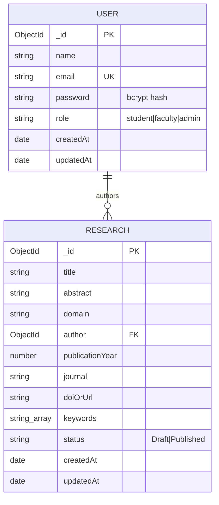

# Faculty Research Data Repository (MERN)

Semester V – MERN Stack Lab, Assignment II – Swami Keshvanand Institute of Technology (SKIT).

Faculty publish and manage their research; students and visitors browse and search published work; administrators manage users and records.

## Tech stack

| Layer | Technology |
|---|---|
| Frontend | React 18 (functional components, hooks), React Router DOM 6, Fetch API, plain CSS, Vite |
| Backend | Node.js, Express, Express Router, controllers + middleware, JWT (`jsonwebtoken`), `bcryptjs`, `dotenv`, `cors` |
| Database | MongoDB with Mongoose (schemas, validation, references, indexes, aggregation) |

## Folder structure

```
faculty-research-repository/
├── client/
│   ├── public/
│   ├── src/
│   │   ├── components/   Navbar, ProtectedRoute, ResearchCard, ResearchForm, ResearchTable
│   │   ├── pages/        Home, Login, Register, ResearchDetails, FacultyDashboard,
│   │   │                 AddResearch, EditResearch, AdminDashboard, NotFound
│   │   ├── context/      AuthContext.jsx (login state shared by all pages)
│   │   ├── services/     api.js (fetch helper), constants.js (domain list)
│   │   ├── App.jsx       routes
│   │   ├── main.jsx      BrowserRouter + AuthProvider
│   │   └── index.css
│   ├── .env.example
│   └── package.json
├── server/
│   ├── config/db.js                 MongoDB connection
│   ├── models/User.js, Research.js  Mongoose schemas
│   ├── controllers/                 authController, researchController, adminController
│   ├── routes/                      authRoutes, researchRoutes, adminRoutes
│   ├── middleware/                  authMiddleware (JWT), roleMiddleware, errorMiddleware
│   ├── scripts/createAdmin.js       creates the first administrator
│   ├── app.js                       Express app (middleware + routes)
│   ├── server.js                    connects to MongoDB and starts listening
│   ├── .env.example
│   └── package.json
├── .gitignore
└── README.md
```

## Setup (Windows)

Prerequisites: Node.js 18+ and either local MongoDB or a free MongoDB Atlas cluster.

### 1. MongoDB

**Option A – Local:** install MongoDB Community Server (it runs as a Windows service). Connection string: `mongodb://127.0.0.1:27017/faculty_research`.

**Option B – Atlas:** create a free cluster at mongodb.com/atlas → Database Access: add a user → Network Access: allow your IP → Connect → Drivers → copy the string, e.g. `mongodb+srv://<user>:<password>@cluster0.xxxxx.mongodb.net/faculty_research`.

### 2. Backend

```powershell
cd server
npm install
copy .env.example .env      # then edit .env
npm run dev                 # or: npm start   → http://localhost:5000
```

### 3. Frontend

```powershell
cd client
npm install
copy .env.example .env
npm run dev                 # → http://localhost:5173
```

### Environment variables

`server/.env`

| Variable | Meaning |
|---|---|
| `PORT` | API port (5000) |
| `MONGODB_URI` | MongoDB connection string |
| `JWT_SECRET` | Long random string used to sign tokens. Generate one: `node -e "console.log(require('crypto').randomBytes(32).toString('hex'))"` |
| `CLIENT_URL` | Frontend origin allowed by CORS (`http://localhost:5173`) |
| `FACULTY_INVITE_CODE` | Secret code required to register as faculty |
| `ADMIN_NAME`, `ADMIN_EMAIL`, `ADMIN_PASSWORD` | Used only by `npm run create-admin` |

`client/.env`

| Variable | Meaning |
|---|---|
| `VITE_API_URL` | Backend base URL, e.g. `http://localhost:5000/api` |

`.env` files are listed in `.gitignore`; only `.env.example` (placeholders) is committed.

### Creating the first administrator securely

Public registration can never create an admin. Instead:

1. Put `ADMIN_NAME`, `ADMIN_EMAIL`, `ADMIN_PASSWORD` (min 8 characters) in `server/.env`.
2. Run `cd server` then `npm run create-admin`.
3. Log in with that email and password. Afterwards you may remove `ADMIN_PASSWORD` from `.env`.

### Faculty accounts

Two controlled routes: (a) the person registers choosing "Faculty" and enters the `FACULTY_INVITE_CODE` that only real faculty know; or (b) an admin changes a student's role to faculty on the Admin Dashboard.

### Authentication approach

After login the server returns a JWT (valid 7 days). The React app stores it in `localStorage` and sends `Authorization: Bearer <token>` on every API call (see `client/src/services/api.js`). This is simple and suitable for an academic project; a production system would prefer httpOnly cookies. Passwords are hashed with bcryptjs and are never returned by the API (`select: false` in the schema).

## API documentation

All responses are JSON: `{ "success": true, "data": ... }` or `{ "success": false, "message": "..." }`.
Protected routes need the header `Authorization: Bearer <token>`.

| Method | Route | Purpose | Auth | Example request | Example response |
|---|---|---|---|---|---|
| POST | `/api/auth/register` | Register (student, or faculty with invite code; never admin) | Public | `{"name":"Dr. Rao","email":"rao@skit.ac.in","password":"secret123","role":"faculty","facultyCode":"CODE"}` | `201 {"success":true,"data":{"token":"...","user":{"id":"..","name":"Dr. Rao","email":"rao@skit.ac.in","role":"faculty"}}}` |
| POST | `/api/auth/login` | Login | Public | `{"email":"rao@skit.ac.in","password":"secret123"}` | `200 {"success":true,"data":{"token":"...","user":{...}}}` ; `401` if wrong |
| GET | `/api/auth/me` | Current user | Logged in | – | `200 {"success":true,"data":{"user":{...}}}` |
| GET | `/api/research?q=&domain=&year=` | Published research; search by title/author/keyword, filter by domain/year | Public | – | `200 {"success":true,"count":1,"data":[{"_id":"..","title":"..","author":{"name":".."},...}]}` |
| GET | `/api/research/mine` | Own records + counts (aggregation) | Faculty/Admin | – | `200 {"success":true,"data":[...],"stats":{"total":3,"published":2,"draft":1}}` |
| GET | `/api/research/:id` | One record. Drafts only for owner/admin (others get 404) | Public (token optional) | – | `200 {"success":true,"data":{...}}` ; `404` |
| POST | `/api/research` | Create record (author = logged-in user) | Faculty/Admin | `{"title":"AI in Agriculture","abstract":"...","domain":"Computer Science","publicationYear":2024,"journal":"IEEE Access","doiOrUrl":"10.1109/xyz","keywords":["ai","farming"],"status":"Published"}` | `201 {"success":true,"data":{...}}` ; `400` on validation errors |
| PUT | `/api/research/:id` | Update record | Owner or Admin | any subset of the create fields | `200 {"success":true,"data":{...}}` ; `403` if not owner |
| DELETE | `/api/research/:id` | Delete record | Owner or Admin | – | `200 {"success":true,"message":"Research deleted"}` |
| GET | `/api/admin/users` | List users | Admin | – | `200 {"success":true,"count":4,"data":[...]}` |
| PUT | `/api/admin/users/:id/role` | Change role to student/faculty (admin role not assignable) | Admin | `{"role":"faculty"}` | `200 {"success":true,"data":{...}}` |
| DELETE | `/api/admin/users/:id` | Delete user **and** their research records | Admin | – | `200 {"success":true,"message":"User deleted along with 2 research record(s)"}` |
| GET | `/api/admin/research` | All records incl. drafts (supporting endpoint for admin table) | Admin | – | `200 {"success":true,"count":5,"data":[...]}` |
| GET | `/api/admin/stats` | Dashboard statistics (aggregation) | Admin | – | `200 {"success":true,"data":{"totalUsers":4,"students":2,"faculty":1,"admins":1,"totalResearch":5,"published":3,"draft":2}}` |

Status codes used: 200, 201, 400 (validation / bad ID), 401 (not logged in / bad token), 403 (wrong role / not owner), 404 (not found), 500 (server error, generic message only).

`/mine` is registered **before** `/:id` in `researchRoutes.js`, otherwise Express would treat "mine" as an ID.

## Database schema

**users** – `name`, `email` (unique index), `password` (bcrypt hash, hidden by default), `role` (`student | faculty | admin`), `createdAt`, `updatedAt`.

**research** – `title`, `abstract`, `domain` (fixed list), `author` (ObjectId → `users`), `publicationYear`, `journal`, `doiOrUrl` (optional), `keywords` ([String]), `status` (`Draft | Published`), `createdAt`, `updatedAt`.

One user (faculty) has many research records; each record has exactly one author. `populate('author', 'name email')` fetches the author without the password.



**Optimization:** compound index `{ status, domain, publicationYear }` for the public listing, index `{ author, status }` for dashboards, and `$group` aggregation pipelines for the dashboard statistics (`adminController.getStats`, `researchController.getMyResearch`).

## Architecture in brief

- `server.js` loads `.env`, connects to MongoDB, starts `app.js`.
- `app.js` wires middleware (CORS, JSON parser, logger), routers, 404 handler and the central error handler.
- **Routes** map URLs to **controllers**; **middleware** (`protect`, `optionalAuth`, `authorize(...roles)`) guards them; **models** define data.
- Ownership is checked inside `researchController` (`record.author.equals(req.user._id)`); admin routes are protected by `router.use(protect, authorize('admin'))`.
- React: `AuthContext` holds the logged-in user; `ProtectedRoute` hides pages by role (convenience only); `services/api.js` wraps `fetch`.

## Postman testing guide

1. Create an environment variable `base` = `http://localhost:5000/api`.
2. **POST** `{{base}}/auth/register` (Body → raw → JSON) with a faculty user and the invite code → copy `data.token`.
3. For protected requests choose Authorization → Bearer Token → paste the token.
4. **POST** `{{base}}/research` with a research body, status `Published` → copy the `_id`.
5. **GET** `{{base}}/research?q=agri&domain=Computer Science&year=2024`.
6. **PUT / DELETE** `{{base}}/research/<id>`.
7. Negative tests: no token → `401`; student token on POST research → `403`; another faculty's token on PUT → `403`; `GET /research/abc` → `400`; register with `"role":"admin"` → `400`.
8. Log in with the admin created by `npm run create-admin` and try `/admin/users` and `/admin/stats`.

## MERN syllabus mapping

| Syllabus topic | Where |
|---|---|
| React functional components, props, hooks (`useState`, `useEffect`, `useRef`) | `client/src/components`, `pages`, `ResearchForm.jsx` (`useRef`) |
| React Router (`BrowserRouter`, `Routes`, `Route`, `Link`, `useNavigate`, `useParams`) | `main.jsx`, `App.jsx`, `Navbar.jsx`, `ResearchDetails.jsx` |
| Context API / protected routes | `context/AuthContext.jsx`, `ProtectedRoute.jsx` |
| Fetch API, async/await, error + loading states | `services/api.js`, all pages |
| Node.js / Express, REST, Router | `server/app.js`, `routes/*` |
| Controllers & middleware | `controllers/*`, `middleware/*` |
| JWT authentication, bcrypt hashing | `authController.js`, `authMiddleware.js` |
| Role-based authorization | `roleMiddleware.js`, `adminRoutes.js` |
| MongoDB + Mongoose schemas, validation, references, `populate` | `models/*`, `researchController.js` |
| Indexes and aggregation | `models/Research.js`, `adminController.getStats` |
| Error handling, CORS, dotenv | `errorMiddleware.js`, `app.js`, `.env.example` |

## Demonstration script (viva)

1. Register as a student → can browse but sees no dashboard.
2. Register as faculty (invite code) → dashboard → add one Draft and one Published record.
3. Log out → Explorer shows only the Published record; opening the Draft's URL gives "Research not found".
4. Search by title/author/keyword; filter by domain and year; search nonsense to see the empty message.
5. Log in as admin → stats, change a role, delete a record, delete a user (their records are removed too).
6. Open MongoDB Compass to show the persisted `users` (hashed passwords) and `research` collections.
